# Awesome-Help-Desk-Customer-Support-Ticketing

  

# 🎧 Awesome Help Desk & Customer Support Ticketing 🎫

  
  
  
  
  
  

> 🌟 **A curated directory of top Help Desk software, Customer Support ticketing systems, shared inboxes, and ITSM service desk solutions — featuring both enterprise SaaS platforms and 100% self-hosted, privacy-first Open-Source software alternatives.**  
> 🌟 *Star this repository if you find it helpful!* 🌟

---

## 📑 Table of Contents

- [🌐 Sector Overview & Market Dynamics](#-sector-overview--market-dynamics)
- [🟦 SaaS / Hosted Platforms](#-saas--hosted-platforms)
- [🟩 Open-Source Software](#-open-source-software)
- [📊 Feature Comparison at a Glance](#-feature-comparison-at-a-glance)
- [📈 Star History](#-star-history)
- [💖 Support & Sponsoring](#-support--sponsoring)
- [🤝 Contributing](#-contributing)
- [📄 License](#-license)

---

## 🌐 Sector Overview & Market Dynamics

The global help desk and customer support ticketing software market is estimated at **$12.0B – $14.3B in 2025–2026**, expanding at a steady CAGR of ~8–9.5% fueled by omni-channel customer expectations and generative AI auto-triage workflows. The sector exhibits a **bifurcated market structure**: it is **moderately concentrated at the top** enterprise layer dominated by scale leaders like HubSpot, Zendesk, and Freshworks, yet remains **highly fragmented across mid-market and SMB segments** where specialized shared inboxes and self-hosted open-source software compete vigorously against vendor lock-in.

---

## 🟦 SaaS / Hosted Platforms

Below is the comparative breakdown of leading commercial customer support and ticketing platforms. The table is ranked and sorted by company scale (**Revenue / Valuation** descending):

| Platform | Company Scale (Revenue / Valuation) | Pricing (Specific Starting Paid Tier) | Free Tier / Free Trial Limits | Key Strengths & Workflows |
|:---|:---|:---|:---|:---|
| 🏢 **HubSpot Service Hub** | ~$3.1B Revenue / ~$15B-$18B Market Cap | **$15/seat/month** (Starter, billed annually) or $20/seat/month (monthly) | **Free Forever Plan**: Capped at 2 users and 1,000 CRM contacts; includes shared inbox, basic live chat widget, and ticketing with HubSpot branding | Seamless CRM integration, customer feedback surveys, unified marketing-to-support lifecycle |
| 🛡️ **Zoho Desk** | ~$1.5B Revenue / ~$12B-$15B Bootstrapped Valuation | **$14/agent/month** (Standard, billed annually) or $20/agent/month (monthly) | **Free Forever Plan**: Maximum 3 agents; email ticketing, private knowledge base, macro tags (no SLA rules or multi-channel) | Deep Zoho ecosystem compatibility, cost-effective scaling for growing support teams |
| 👑 **Zendesk Support** | ~$2.0B ARR / $10.2B Acquisition Valuation | **$19/agent/month** (Support Team, billed annually) or $25/agent/month (monthly) | **14-day Free Trial**: Full access to all platform features; no credit card required upfront | Industry-standard ticketing powerhouse, comprehensive App Marketplace, robust SLA workflows |
| 🚀 **SolarWinds Service Desk** | ~$800M ARR / $4.4B Acquisition Valuation | **$39/technician/month** (Essentials, billed annually) | **30-day Free Trial**: Full access to all Premier ITSM features and ticketing workflows; no credit card required | ITIL-aligned IT service desk, IT asset tracking (ITAM), change management, problem resolution |
| ⚡ **Freshdesk** | ~$839M Revenue / ~$3.5B Market Cap | **$19/agent/month** (Growth, billed annually) or $23/agent/month (monthly) | **6-month Free Program**: Up to 2 agents maximum; basic email ticketing, knowledge base, and ticket dispatch | Intuitive modern interface, Freshworks ecosystem synergy, automated ticket dispatching rules |
| 📬 **Front** | ~$100M+ ARR / $1.7B Valuation | **$25/seat/month** (Starter, billed annually; max 10 seats) | **14-day Free Trial**: Grants full trial access to Professional plan features; no credit card required | Collaborative shared inbox turning emails into actionable team conversations and assignments |
| 🦊 **HappyFox** | ~$20M ARR (Bootstrapped) | **$24/agent/month** (Basic, billed annually; max 5 agents) | **14-day Free Trial**: Full access to Help Desk ticketing and automation features; no credit card required | Robust ticket queues, multi-brand portal support, custom agent performance reporting |
| 💌 **Help Scout** | ~$34M-$38M Revenue / ~$30M ARR | **$25/user/month** (Standard, billed annually) or $30/user/month (monthly) | **Free Forever Plan**: Maximum 5 users, capped strictly at 100 helped contacts/month, 1 shared inbox, 1 Docs site (10 articles max) | Customer-delight focused email support, simplicity, Docs knowledge base, zero ticket clutter |
| 💬 **LiveAgent** | ~$6.5M ARR (Bootstrapped) | **$15/agent/month** (Small Business, billed annually) or $19/agent/month (monthly) | **Free Forever Plan**: Ticket history search limited to past 7 days, 1 email account, 1 live chat button, no automation rules; or 30-day full-feature trial | All-in-one help desk combining fast live chat, native VoIP call center, and email queues |
| 🎯 **Kayako** | Private (ESW Capital / Lodestone) | **$79/agent/month** (Kayako One, starting base tier) | **14-day Free Trial**: Full access to omnichannel ticketing and live conversation tools; no credit card required | Unified customer journey timeline, real-time internal team collaboration, customer tracking |

---

## 🟩 Open-Source Software

Self-hosted, transparent, and privacy-respecting customer support platforms that you can run on your own infrastructure. All repos are organized and sorted by **GitHub Star Count (descending)**:

| Project | Stars (Badge & Stargazers Link) | Tech Stack | License | Key Features & Strengths |
|:---|:---:|:---|:---|:---|
| 💬 **[Chatwoot](https://github.com/chatwoot/chatwoot)** |  | Ruby on Rails, Vue.js, PostgreSQL, Redis | MIT | Omni-channel customer communication hub covering live chat, email, WhatsApp, Telegram, Facebook, and Instagram with AI Captain triage. Modern Intercom alternative. |
| 📦 **[UVdesk](https://github.com/uvdesk/community-skeleton)** |  | PHP (Symfony), MySQL | OSL-3.0 | Modular open-source helpdesk with unlimited ticket queues, customer knowledge portal, and e-commerce marketplace connectors (Magento, Shopify, WooCommerce). |
| 🖥️ **[GLPI](https://github.com/glpi-project/glpi)** |  | PHP, MariaDB / MySQL | GPL-3.0 | Comprehensive ITIL Service Desk paired with IT asset management (ITAM), hardware inventory, data center tracking, and CMDB capabilities. |
| 🦊 **[Zammad](https://github.com/zammad/zammad)** |  | Ruby on Rails, Vue.js, PostgreSQL/MySQL, Elasticsearch | AGPL-3.0 | Clean, real-time ticket desk supporting email, chat, phone (SIP/CTI), SMS, WhatsApp, and Telegram. Features built-in Zendesk/Freshdesk importers, SLAs, and free SAML/OIDC SSO. |
| 📬 **[FreeScout](https://github.com/freescout-help-desk/freescout)** |  | PHP (Laravel), MySQL | AGPL-3.0 | Lightweight, self-hosted alternative to Help Scout. Free core includes unlimited mailboxes, users, and tickets. Operates efficiently on minimal 1-2 GB RAM setups. |
| 📨 **[osTicket](https://github.com/osTicket/osTicket)** |  | PHP, MySQL | GPL-2.0 | Time-tested, reliable open-source support ticket system. Converts email and web inquiries into managed tickets with SLAs, department queues, and customer self-service portal. |
| ⚡ **[Chaskiq](https://github.com/chaskiq/chaskiq)** |  | Ruby on Rails, React, PostgreSQL | Apache-2.0 | Full-featured conversational customer support, messaging, and onboarding platform designed as an open-source alternative to Intercom, Drift, and Crisp. |
| 🏢 **[Frappe Helpdesk](https://github.com/frappe/helpdesk)** |  | Python, Vue.js, Frappe Framework, MariaDB | GPL-3.0 | Modern customer service software tailored for ERPNext users. Features custom SLAs with business hours, automated assignment, knowledge base, and zero seat restrictions. |
| 🌿 **[Peppermint](https://github.com/Peppermint-Lab/peppermint)** |  | TypeScript, Node.js, React, SQLite / PostgreSQL | MIT | Modern, lightweight ticket management and issue tracking solution designed as a privacy-friendly alternative to Zendesk and Jira Service Management. |
| 🚀 **[Libredesk](https://github.com/abhinavxd/libredesk)** |  | Go, SQLite / PostgreSQL | AGPL-3.0 | Single-binary, ultra-lightweight customer support inbox and live chat widget. Extremely simple self-hosting with minimal resource consumption. |
| 🕊️ **[GO-FLY](https://github.com/taoshihan1991/goflylivechat)** |  | Go, Gin, WebSocket, MySQL | AGPL-3.0 | High-performance, self-hosted real-time customer service live chat software powered by Golang. Capable of handling thousands of concurrent chat sessions. |
| 💡 **[Helpy](https://github.com/helpyio/helpy)** |  | Ruby on Rails, PostgreSQL | MIT | Modern, mobile-first help desk featuring multi-channel email ticketing, searchable knowledge base, and community discussion boards. |
| 🛡️ **[Trudesk](https://github.com/polonel/trudesk)** |  | Node.js, MongoDB, Elasticsearch | Apache-2.0 | Open-source help desk ticketing solution built on Node.js and MongoDB. Real-time updates, custom role management, and clean administrative dashboards. |
| 🎫 **[Faveo Helpdesk](https://github.com/faveosuite/faveo-helpdesk)** |  | PHP (Laravel), MySQL | GPL-3.0 | Enterprise-grade helpdesk system providing ticket management, built-in knowledge base, SLA tracking, and multi-channel ticket intake. |
| 🗄️ **[Request Tracker (RT)](https://github.com/bestpractical/rt)** |  | Perl, MySQL / PostgreSQL / Oracle | GPL-2.0 | Battle-tested, enterprise-grade ticketing and workflow system deployed worldwide by universities, ISPs, and network operations centers with granular access control. |
| 🤖 **[Cossistant](https://github.com/cossistantcom/cossistant)** |  | TypeScript, Next.js, Python | AGPL-3.0 | AI-native open-source customer support platform with customizable AI support agents designed specifically for modern SaaS developers. |
| 🔄 **[Znuny](https://github.com/znuny/Znuny)** |  | Perl, MariaDB / MySQL / PostgreSQL | GPL-3.0 | Popular community fork of OTRS. Robust queue and process management for enterprise IT service desks requiring rigid ITIL compliance. |
| ⚙️ **[OTOBO](https://github.com/RotherOSS/otobo)** |  | Perl, MariaDB / PostgreSQL / Oracle | GPL-3.0 | Next-generation OTRS fork by Rother OSS with free ITSM modules, responsive customer portal, and comprehensive incident/change management. |
| ⚓ **[Helpdock](https://github.com/Docker-Hunterpedia/Helpdock)** |  | Docker, PostgreSQL, S3 Storage | AGPL-3.0 | Security-conscious self-hosted support desk with multi-brand routing, live chat widget, grounded AI assistant, and SAML/OIDC SSO. |

---

## 📊 Feature Comparison at a Glance

| Software | License | Tech Stack | Best For | Free SSO | Omni-Channel / Live Chat |
|:---|:---|:---|:---|:---:|:---:|
| **Chatwoot** | MIT | Ruby / Rails | Conversational Omni-Channel Support | ✅ | ✅ Full (Chat, Email, WhatsApp, Social) |
| **UVdesk** | OSL-3.0 | PHP / Symfony | E-Commerce & Marketplace Connectors | ❌ | ❌ Email & Portal Focused |
| **GLPI** | GPL-3.0 | PHP | IT Help Desk + Asset Tracking (CMDB) | ✅ | ❌ ITIL Focused |
| **Zammad** | AGPL-3.0 | Ruby / Rails | Modern Enterprise SaaS Experience | ✅ (SAML/OIDC) | ✅ Omnichannel (Chat, Email, SIP, Social) |
| **FreeScout** | AGPL-3.0 | PHP / Laravel | Lightweight Shared Inbox (Help Scout Alt) | ❌ (Module) | ❌ Email Focused |
| **osTicket** | GPL-2.0 | PHP | Simple Budget Email Ticketing | ❌ (Plugin) | ❌ Email / Web Form |
| **Chaskiq** | Apache-2.0 | Ruby / React | Conversational Support & Marketing | ✅ | ✅ Live Chat & Messaging |
| **Frappe Helpdesk**| GPL-3.0+ | Python / Vue | ERPNext & Frappe Framework Ecosystem | ✅ (Frappe) | ❌ Email & Portal |
| **Peppermint** | MIT | TypeScript / React | Minimalist Issue & Ticket Tracking | ❌ | ❌ Ticket Focused |
| **Libredesk** | AGPL-3.0 | Go | Single-Binary Fast Deployment | ❌ | ✅ Live Chat Widget |
| **Request Tracker**| GPL-2.0 | Perl | Deep Queue & Permission Control | ❌ (Server mod) | ❌ Email Driven |
| **OTOBO** | GPL-3.0 | Perl | Full OTRS-Style ITIL Service Desk | ✅ | ❌ Email & Web Portal |
| **Helpdock** | AGPL-3.0 | Docker / Postgres | Multi-Brand Support with Built-in AI | ✅ (SAML/OIDC) | ✅ Live Chat Widget |

---

## 📈 Star History

---

## 💖 Support & Sponsoring

Thank you for visiting and using this curated directory! If this project helps you identify the best customer support software or open-source ticketing solution for your team, please consider supporting the project:

- ⭐ **Star** this repository to help others discover it.
- 🍴 **Fork** and contribute your favorite open-source tools and updates.
- 📢 **Share** this list with engineering colleagues, DevOps leads, and support managers.
- ☕ **Buy me a coffee / Sponsor**: If you'd like to support continued maintenance and development, please visit the [GitHub Sponsors Dashboard](https://github.com/sponsors/ishandutta2007).

Your backing and encouragement are greatly appreciated! 🙏✨

---

## 🤝 Contributing

Contributions are warmly welcomed! If you know of an outstanding open-source help desk, shared inbox, or customer ticketing software that meets the criteria:

1. Fork this repository.
2. Add your entry following the established table structure.
3. Ensure the project is actively maintained (commits within the last 12 months) and possesses a valid open-source license.
4. Submit a Pull Request with a short summary of why it belongs here.

---

## 📄 License

This repository is published under the [Creative Commons Zero v1.0 Universal](LICENSE) (CC0 1.0 - Public Domain Dedication). All respective software names, logos, and trademarks belong to their respective project maintainers.

---

  ⭐ <b>Found this resource valuable? Don't forget to star the repository!</b> ⭐

